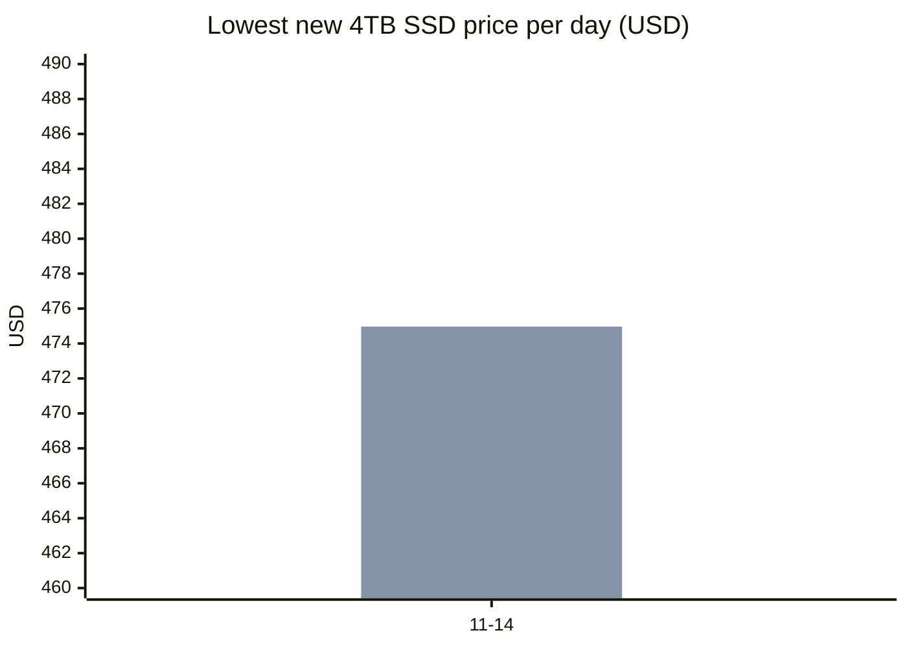
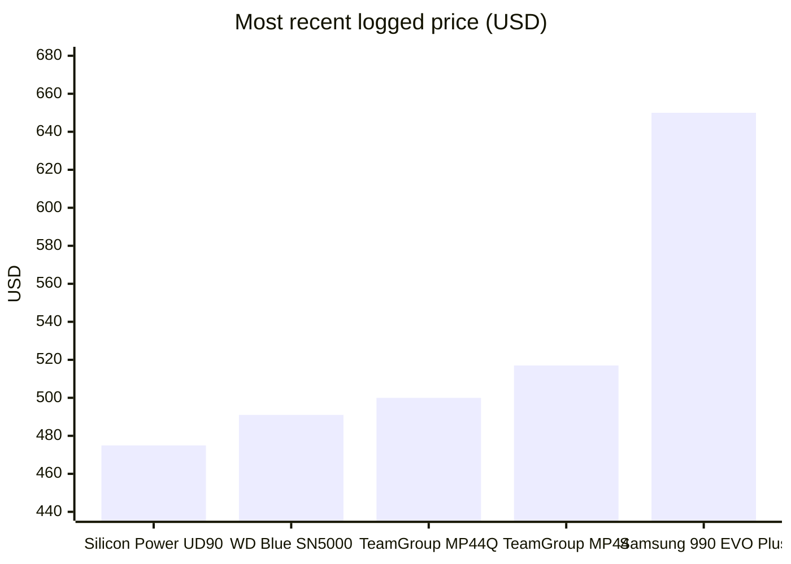
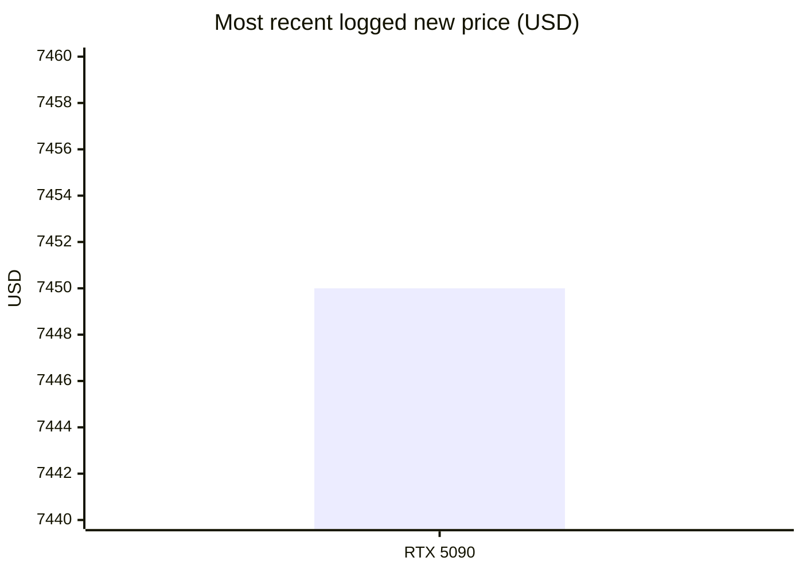
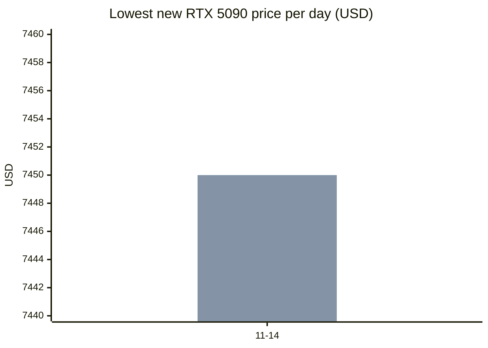

# Nitro V 16S Upgrade Price Watch

Daily US prices (USD) for upgrades and GPUs for an Acer Nitro V 16S (ANV16S-71), in five categories:

| Category | What's tracked |
|---|---|
| `ssd` | 4TB M.2 2280 NVMe PCIe 4.0 SSDs without a heatsink (Lexar NM790, TeamGroup MP44 and T-Force G50, WD Black SN7100 and SN850X, WD Blue SN5000, Samsung 990 EVO Plus and 990 Pro, Crucial T500 and P310, Kingston KC3000, Silicon Power UD90 and other reputable brands), plus the Micron 2500 |
| `ram` | Single 64GB DDR5 SO-DIMM modules, non-ECC, 5600 MT/s or faster |
| `nvidia_gpu` | Desktop RTX 5090, 4090, 3090 Ti and 3090, new and used/refurbished |
| `amd_gpu` | Desktop RX 9070 XT, 9070, 7900 XTX and 7900 XT (plus any newer Radeon above the 9070 XT), new and used/refurbished |
| `egpu` | Thunderbolt/USB4 eGPU enclosures and complete external GPUs |

Stores: Amazon, eBay, Newegg, Best Buy, Walmart, B&H Photo and Micro Center.

**DEAL flags (🔥):**
- A new 4TB TLC SSD at $450 or less (SSDs only).
- In any category, a price at least 10% below the previous logged price for the same item, store and condition.
- In any category, a price strictly below every earlier price for that item and condition, once there are at least 7 days of history.

## How it works

- A daily routine adds prices to [`prices.csv`](prices.csv) (`date,category,item,spec,store,condition,price_usd,basis,source_date,url`) and writes notes to [`claude.md`](claude.md).
- [`scripts/build_readme.py`](scripts/build_readme.py) rebuilds the dashboard below. GPUs are grouped by model.
- The [Update README dashboard](.github/workflows/update-readme.yml) Action runs the script whenever `prices.csv` or the script changes on `main`. To run it yourself:

```bash
python3 scripts/build_readme.py
```

Only the text between the `PRICES:START` and `PRICES:END` markers is regenerated. Everything above them can be edited by hand.

## Dashboard

<!-- PRICES:START -->
**Last check:** 2026-11-14 &nbsp;·&nbsp; **Prices logged:** 12 &nbsp;·&nbsp; **Items tracked with prices:** 7 across 2 categories

> No DEAL flags on the latest check.

| Category | Latest-check rows | Cheapest new on latest check |
|---|--:|---|
| SSDs | 9 | Silicon Power UD90 — $474.97 (Amazon) |
| NVIDIA GPUs | 3 | RTX 5090 (ASUS TUF Gaming OC) — $7,450.00 (Amazon) |

### SSDs

> **Cheapest new 4TB TLC SSD on 2026-11-14:** Silicon Power UD90 (4TB TLC (some batches reported QLC)) at **$474.97** (Amazon) — [source](https://www.pcgamer.com/black-friday-ssd-deals/)

#### Cheapest new 4TB SSD price over time



#### Latest price by item (new, cheapest store)



#### Latest prices

| Item | Spec | Store | Condition | Price | Change | As of | Basis | Link |
|---|---|---|---|--:|--:|---|---|---|
| Silicon Power UD90 | 4TB TLC (some batches reported QLC) | Amazon | new | **$474.97** | — | 2026-11-14 | reported (PC Gamer) | [link](https://www.pcgamer.com/black-friday-ssd-deals/) |
| Silicon Power UD90 | 4TB TLC (some batches reported QLC) | Newegg | new | **$475.00** | new | 2026-11-14 | reported (PC Gamer) | [link](https://www.pcgamer.com/black-friday-ssd-deals/) |
| WD Blue SN5000 | 4TB QLC | Newegg | new | **$491.00** | new | 2026-11-14 | reported (PC Gamer) | [link](https://www.pcgamer.com/black-friday-ssd-deals/) |
| TeamGroup MP44Q | 4TB QLC | Amazon | new | **$499.99** | — | 2026-11-14 | reported (PC Gamer) | [link](https://www.pcgamer.com/black-friday-ssd-deals/) |
| TeamGroup MP44 | 4TB TLC | Newegg | new | **$516.99** | new | 2026-11-14 | reported (PC Gamer) | [link](https://www.pcgamer.com/black-friday-ssd-deals/) |
| Samsung 990 EVO Plus | 4TB TLC | B&H Photo | new | **$649.99** | — | 2026-11-14 | reported (9to5Toys) | [link](https://9to5toys.com/2026/11/14/this-weeks-pc-deals-and-news/) |

<details>
<summary><b>SSDs: price history</b></summary>

##### Samsung 990 EVO Plus — B&H Photo (new)
Low $649.99 · High $649.99 · 2 entries

| Date | Price | Basis |
|---|--:|---|
| 2026-11-14 | [$649.99](https://9to5toys.com/2026/11/14/this-weeks-pc-deals-and-news/) | reported (9to5Toys) |
| 2026-11-14 | [$649.99](https://9to5toys.com/2026/11/14/this-weeks-pc-deals-and-news/) | reported (9to5Toys) |

##### Silicon Power UD90 — Amazon (new)
Low $474.97 · High $474.97 · 2 entries

| Date | Price | Basis |
|---|--:|---|
| 2026-11-14 | [$474.97](https://www.pcgamer.com/black-friday-ssd-deals/) | reported (PC Gamer) |
| 2026-11-14 | [$474.97](https://www.pcgamer.com/best-ssd-deals-today/) | reported (PC Gamer) |

##### Silicon Power UD90 — Newegg (new)
Low $475.00 · High $475.00 · 1 entry

| Date | Price | Basis |
|---|--:|---|
| 2026-11-14 | [$475.00](https://www.pcgamer.com/black-friday-ssd-deals/) | reported (PC Gamer) |

##### TeamGroup MP44 — Newegg (new)
Low $516.99 · High $516.99 · 1 entry

| Date | Price | Basis |
|---|--:|---|
| 2026-11-14 | [$516.99](https://www.pcgamer.com/black-friday-ssd-deals/) | reported (PC Gamer) |

##### TeamGroup MP44Q — Amazon (new)
Low $499.99 · High $499.99 · 2 entries

| Date | Price | Basis |
|---|--:|---|
| 2026-11-14 | [$499.99](https://www.pcgamer.com/black-friday-ssd-deals/) | reported (PC Gamer) |
| 2026-11-14 | [$499.99](https://www.pcgamer.com/best-ssd-deals-today/) | reported (PC Gamer) |

##### WD Blue SN5000 — Newegg (new)
Low $491.00 · High $491.00 · 1 entry

| Date | Price | Basis |
|---|--:|---|
| 2026-11-14 | [$491.00](https://www.pcgamer.com/black-friday-ssd-deals/) | reported (PC Gamer) |

</details>

### NVIDIA GPUs

> **Cheapest new NVIDIA GPU on 2026-11-14:** RTX 5090 (ASUS TUF Gaming OC) (32GB GDDR7) at **$7,450.00** (Amazon) — [source](https://videocardprices.com/card/nvidia-rtx-5090/)

#### Cheapest by model

| Model | Cheapest new | Cheapest used / refurbished |
|---|---|---|
| RTX 5090 | [$7,450.00](https://videocardprices.com/card/nvidia-rtx-5090/) Amazon, 2026-11-14 | — |
| RTX 4090 | — | — |
| RTX 3090 Ti | — | — |
| RTX 3090 | — | [$1,799.22](https://camelcamelcamel.com/product/B08HR6ZBYJ) Amazon (third-party seller), 2026-11-14 |

<sub>Uses the most recent logged price for each item, store and condition.</sub>

#### Latest new price by model (cheapest store)



<details>
<summary><b>New price over time, by model</b></summary>

#### RTX 5090: cheapest new price over time



</details>

#### Latest prices

| Model | Item | Spec | Store | Condition | Price | Change | As of | Basis | Link |
|---|---|---|---|---|--:|--:|---|---|---|
| RTX 5090 | RTX 5090 (ASUS TUF Gaming OC) | 32GB GDDR7 | Amazon | new | **$7,450.00** | — | 2026-11-14 | reported (videocardprices.com) | [link](https://videocardprices.com/card/nvidia-rtx-5090/) |
| RTX 3090 | RTX 3090 (NVIDIA Founders Edition) | 24GB GDDR6X | Amazon (third-party seller) | used | **$1,799.22** | new | 2026-11-14 | reported (camelcamelcamel) | [link](https://camelcamelcamel.com/product/B08HR6ZBYJ) |

<details>
<summary><b>NVIDIA GPUs: price history</b></summary>

##### RTX 3090 (NVIDIA Founders Edition) — Amazon (third-party seller) (used)
Low $1,799.22 · High $1,799.22 · 1 entry

| Date | Price | Basis |
|---|--:|---|
| 2026-11-14 | [$1,799.22](https://camelcamelcamel.com/product/B08HR6ZBYJ) | reported (camelcamelcamel) |

##### RTX 5090 (ASUS TUF Gaming OC) — Amazon (new)
Low $7,450.00 · High $7,450.00 · 2 entries

| Date | Price | Basis |
|---|--:|---|
| 2026-11-14 | [$7,450.00](https://videocardprices.com/card/nvidia-rtx-5090/) | reported (videocardprices.com) |
| 2026-11-14 | [$7,450.00](https://videocardprices.com/card/nvidia-rtx-5090/) | reported (videocardprices.com) |

</details>

🔥 = DEAL: a new 4TB TLC SSD at $450.00 or less (SSDs only); or, in any category, a price at least 10% below the previous logged price for the same item, store and condition, or strictly below every earlier price for that item and condition once prices.csv has at least 7 days of history. Change is against the previous logged price for the same item, store and condition.

<sub>Generated from [`prices.csv`](prices.csv) by [`scripts/build_readme.py`](scripts/build_readme.py). Daily notes are in [`claude.md`](claude.md).</sub>
<!-- PRICES:END -->
