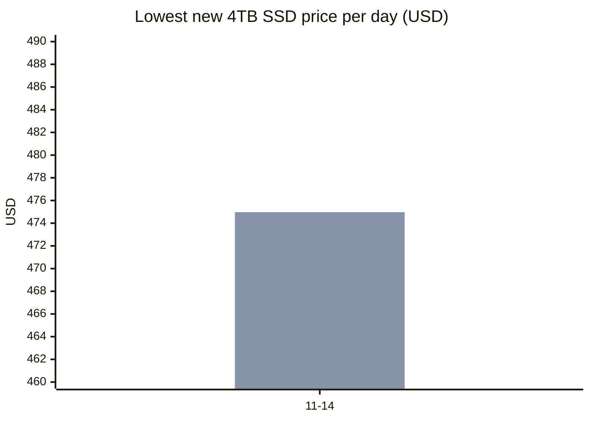
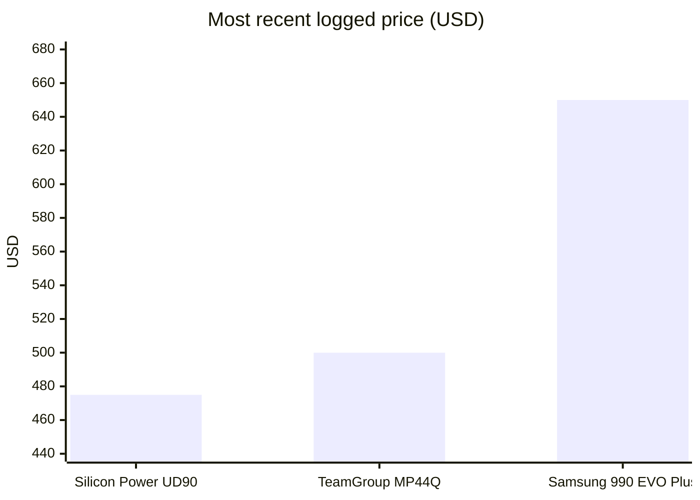
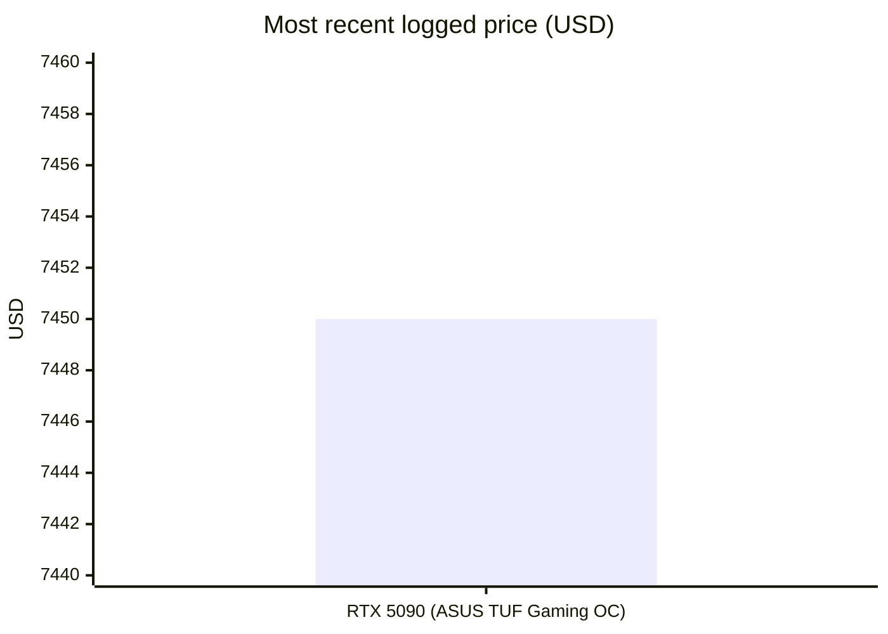

# 4TB SSD Price Watch

Daily US prices for 4TB M.2 2280 NVMe PCIe 4.0 SSDs (no heatsink) that fit an Acer Nitro V 16S (ANV16S-71), plus the Micron 2500.

The dashboard below is rebuilt automatically from [`prices.csv`](prices.csv) whenever it changes.

<!-- PRICES:START -->
**Last check:** 2026-11-14 &nbsp;·&nbsp; **Prices logged:** 4 &nbsp;·&nbsp; **Items tracked with prices:** 4 across 2 categories

> No DEAL flags on the latest check.

| Category | Latest-check rows | Cheapest new on latest check |
|---|--:|---|
| SSDs | 3 | Silicon Power UD90 — $474.97 (Amazon) |
| NVIDIA GPUs | 1 | RTX 5090 (ASUS TUF Gaming OC) — $7,450.00 (Amazon) |

### SSDs

> **Cheapest new 4TB TLC SSD on 2026-11-14:** Silicon Power UD90 (4TB TLC (some batches reported QLC)) at **$474.97** (Amazon) — [source](https://www.pcgamer.com/best-ssd-deals-today/)

#### Cheapest new 4TB SSD price over time

#### Latest price by item (new, cheapest store)

#### Latest prices

| Item | Spec | Store | Condition | Price | Change | As of | Basis | Link |
|---|---|---|---|--:|--:|---|---|---|
| Silicon Power UD90 | 4TB TLC (some batches reported QLC) | Amazon | new | **$474.97** | new | 2026-11-14 | reported (PC Gamer) | [link](https://www.pcgamer.com/best-ssd-deals-today/) |
| TeamGroup MP44Q | 4TB QLC | Amazon | new | **$499.99** | new | 2026-11-14 | reported (PC Gamer) | [link](https://www.pcgamer.com/best-ssd-deals-today/) |
| Samsung 990 EVO Plus | 4TB, flash type not confirmed | B&H Photo | new | **$649.99** | new | 2026-11-14 | reported (9to5Toys) | [link](https://9to5toys.com/2026/11/14/this-weeks-pc-deals-and-news/) |

<b>SSDs: price history</b>

##### Samsung 990 EVO Plus — B&H Photo (new)
Low $649.99 · High $649.99 · 1 entry

| Date | Price | Basis |
|---|--:|---|
| 2026-11-14 | [$649.99](https://9to5toys.com/2026/11/14/this-weeks-pc-deals-and-news/) | reported (9to5Toys) |

##### Silicon Power UD90 — Amazon (new)
Low $474.97 · High $474.97 · 1 entry

| Date | Price | Basis |
|---|--:|---|
| 2026-11-14 | [$474.97](https://www.pcgamer.com/best-ssd-deals-today/) | reported (PC Gamer) |

##### TeamGroup MP44Q — Amazon (new)
Low $499.99 · High $499.99 · 1 entry

| Date | Price | Basis |
|---|--:|---|
| 2026-11-14 | [$499.99](https://www.pcgamer.com/best-ssd-deals-today/) | reported (PC Gamer) |

### NVIDIA GPUs

> **Cheapest new NVIDIA GPU on 2026-11-14:** RTX 5090 (ASUS TUF Gaming OC) (32GB GDDR7) at **$7,450.00** (Amazon) — [source](https://videocardprices.com/card/nvidia-rtx-5090/)

#### Cheapest new NVIDIA GPU price over time

#### Latest price by item (new, cheapest store)

#### Latest prices

| Item | Spec | Store | Condition | Price | Change | As of | Basis | Link |
|---|---|---|---|--:|--:|---|---|---|
| RTX 5090 (ASUS TUF Gaming OC) | 32GB GDDR7 | Amazon | new | **$7,450.00** | new | 2026-11-14 | reported (videocardprices.com) | [link](https://videocardprices.com/card/nvidia-rtx-5090/) |

<b>NVIDIA GPUs: price history</b>

##### RTX 5090 (ASUS TUF Gaming OC) — Amazon (new)
Low $7,450.00 · High $7,450.00 · 1 entry

| Date | Price | Basis |
|---|--:|---|
| 2026-11-14 | [$7,450.00](https://videocardprices.com/card/nvidia-rtx-5090/) | reported (videocardprices.com) |

🔥 = DEAL: a new 4TB TLC SSD at $450.00 or less (SSDs only); or, in any category, a price at least 10% below the previous logged price for the same item, store and condition, or strictly below every earlier price for that item and condition once prices.csv has at least 7 days of history. Change is against the previous logged price for the same item, store and condition.

Generated from [`prices.csv`](prices.csv) by [`scripts/build_readme.py`](scripts/build_readme.py). Daily notes are in [`claude.md`](claude.md).
<!-- PRICES:END -->
