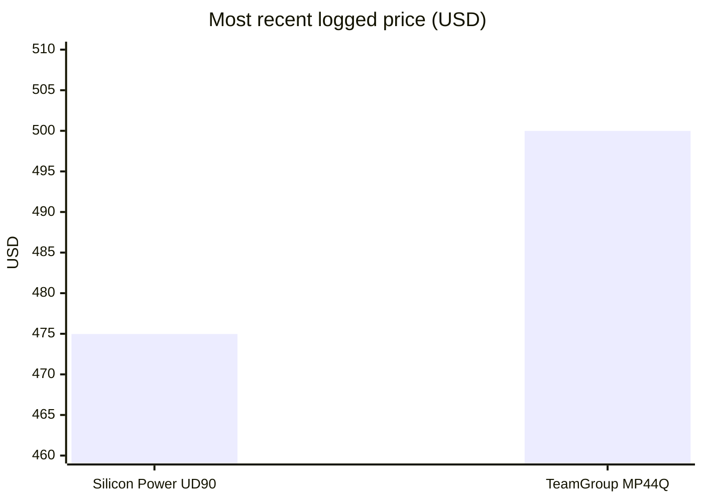

# 4TB SSD Price Watch

Daily US prices for 4TB M.2 2280 NVMe PCIe 4.0 SSDs (no heatsink) that fit an Acer Nitro V 16S (ANV16S-71), plus the Micron 2500.

The dashboard below is rebuilt automatically from [`prices.csv`](prices.csv) whenever it changes.

<!-- PRICES:START -->
**Last check:** 2026-11-14 &nbsp;·&nbsp; **Prices logged:** 2 &nbsp;·&nbsp; **Drives tracked with prices:** 2

> **Cheapest new 4TB TLC drive on 2026-11-14:** Silicon Power UD90 at **$474.97** (Amazon) — [source](https://www.pcgamer.com/best-ssd-deals-today/)
>
> No DEAL flags on the latest check.

### Cheapest new 4TB price over time

### Latest 4TB price by drive (new, cheapest store)

### Latest prices

| Drive | Flash | Store | Condition | Price | Change | As of | Basis | Link |
|---|---|---|---|--:|--:|---|---|---|
| Silicon Power UD90 | TLC (some batches reported QLC) | Amazon | new | **$474.97** | new | 2026-11-14 | reported (PC Gamer) | [link](https://www.pcgamer.com/best-ssd-deals-today/) |
| TeamGroup MP44Q | QLC | Amazon | new | **$499.99** | new | 2026-11-14 | reported (PC Gamer) | [link](https://www.pcgamer.com/best-ssd-deals-today/) |

🔥 = DEAL (new 4TB TLC at $450 or less, or at least 10% below its previous price). Change is against the previous logged price for the same drive, store and condition.

<b>Price history by drive</b>

#### Silicon Power UD90 — Amazon (new)
Low $474.97 · High $474.97 · 1 entry

| Date | Price | Basis |
|---|--:|---|
| 2026-11-14 | [$474.97](https://www.pcgamer.com/best-ssd-deals-today/) | reported (PC Gamer) |

#### TeamGroup MP44Q — Amazon (new)
Low $499.99 · High $499.99 · 1 entry

| Date | Price | Basis |
|---|--:|---|
| 2026-11-14 | [$499.99](https://www.pcgamer.com/best-ssd-deals-today/) | reported (PC Gamer) |

Generated from [`prices.csv`](prices.csv) by [`scripts/build_readme.py`](scripts/build_readme.py). Daily notes are in [`claude.md`](claude.md).
<!-- PRICES:END -->
